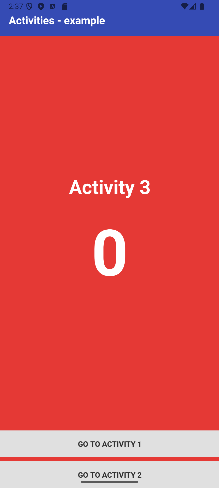

# ActivitiesApp (RMA - Naloga 5)

A multi-activity Android application built for the **Razvoj mobilnih aplikacij (RMA)** course. This project demonstrates navigation between multiple Android activities, data passing via Intent extras, state persistence across configuration changes, and touch swipe gestures.

---

## 📱 Screenshots

<p align="center">
  
  
</p>

---

## 🚀 Features

- **Counter State Management**: Increment the counter in `MainActivity` and pass its value between activities using `Intent.putExtra()` and `getIntExtra()`.
- **State Retention**: Retain counter state across screen rotations using `onSaveInstanceState()`.
- **Activity Navigation**:
    - Button-based navigation between `MainActivity`, `HelloActivity`, and `ThirdActivity`.
    - Uses `FLAG_ACTIVITY_CLEAR_TOP` and `FLAG_ACTIVITY_SINGLE_TOP` to handle back-stack navigation cleanly.
- **Swipe Gesture Navigation (`ThirdActivity`)**:
    - **Swipe Left**: Navigates to `MainActivity`.
    - **Swipe Right**: Navigates to `HelloActivity`.

---

## 🛠️ Architecture & Structure

```text
app/src/main/java/com/domenkoder/activitiesapp/
├── MainActivity.java    # Main screen with counter control and navigation triggers
├── HelloActivity.java   # Displays "Hello!" with the passed counter value
└── ThirdActivity.java   # Displays "Activity 3", counter value, buttons & swipe listener
```

---

## ⚙️ Setup & Build

1. Clone the repository:

   ```bash
   git clone https://github.com/your-username/ActivitiesApp.git
   ```

2. Open the project in **Android Studio** (Ladybug / 2024.2+ recommended).

3. Let Gradle sync and run the application on an Android emulator or physical device.

    - Minimum SDK: 24 (Android 7.0+).

### Build from the command line

```bash
./gradlew assembleDebug
```